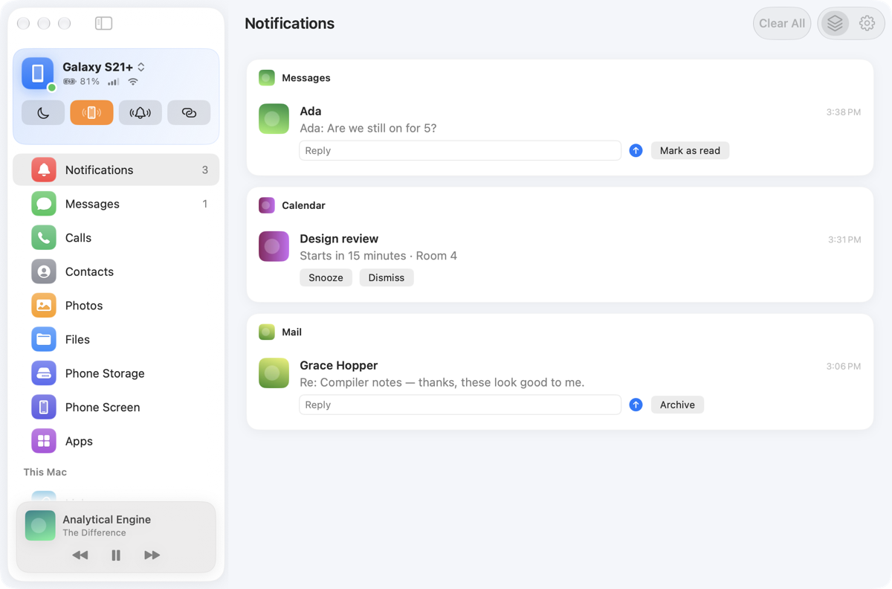
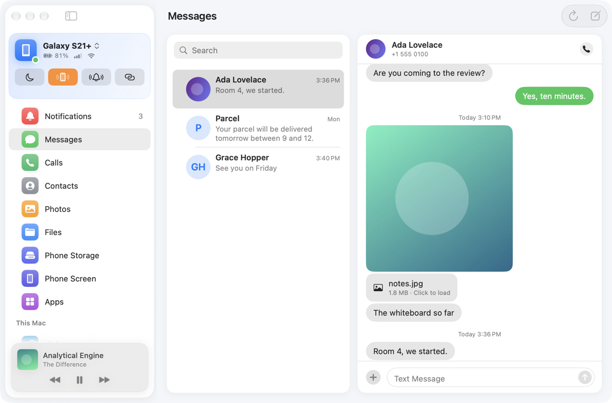
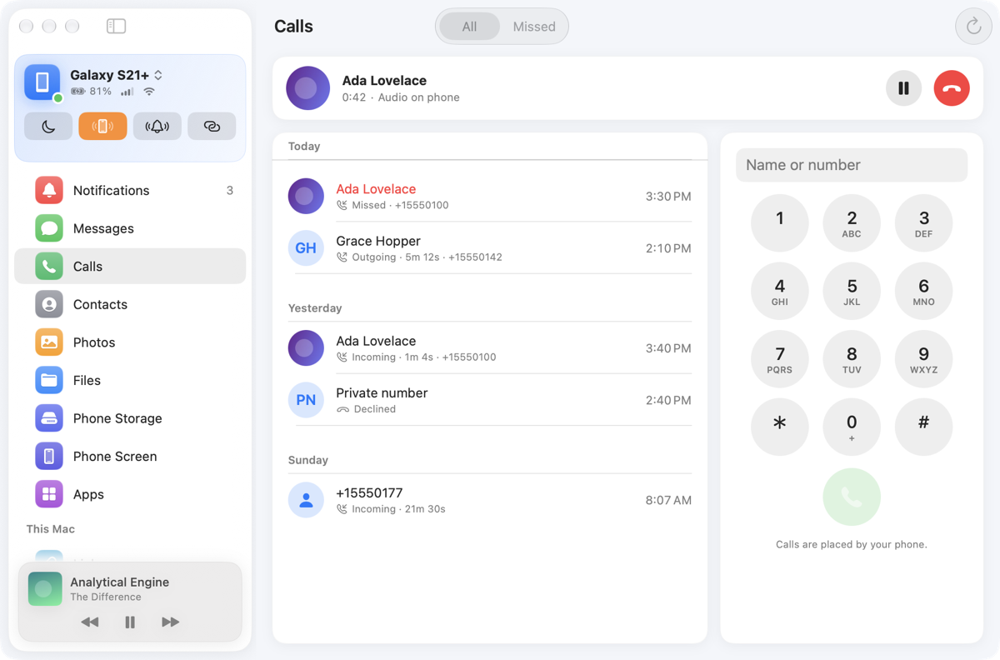
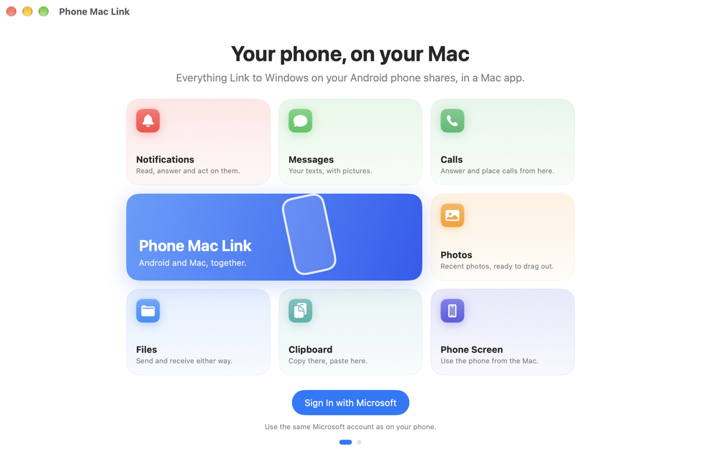
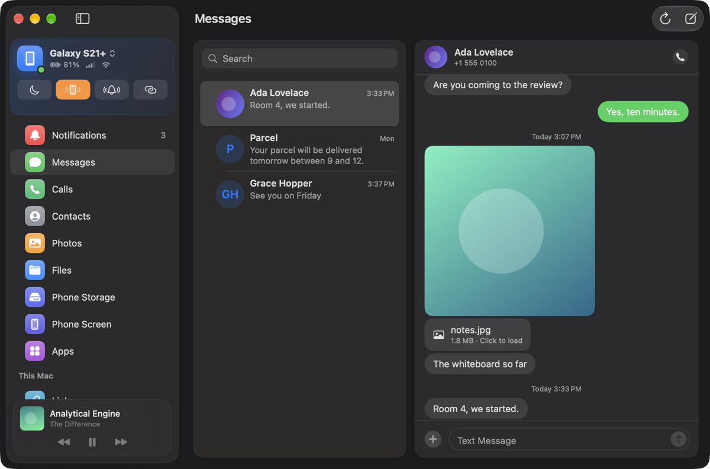
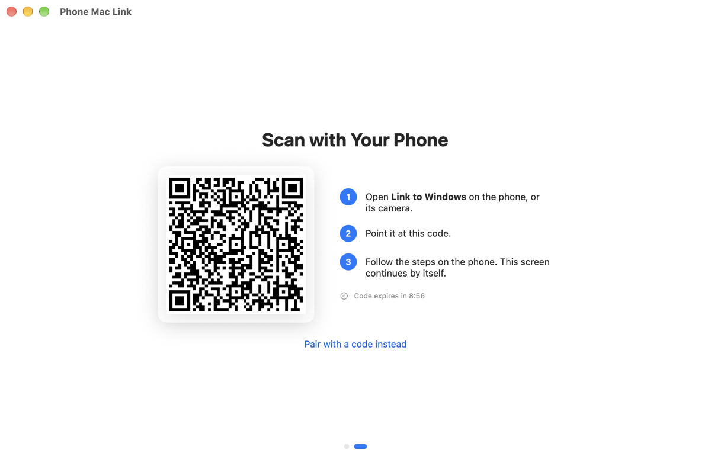
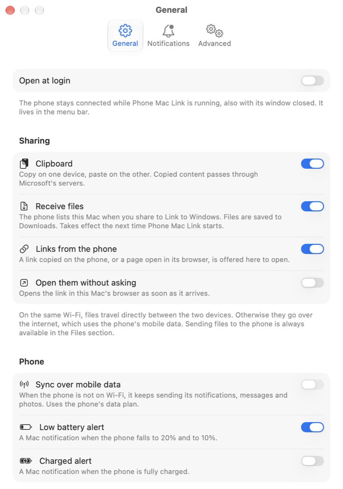
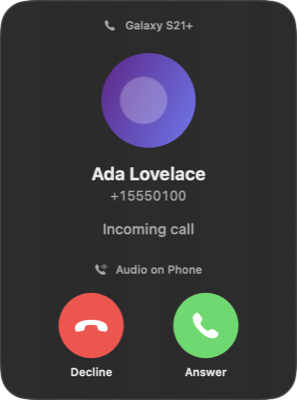

# Android Mac Link

**Phone Mac Link** is a native macOS app that links an Android phone to a Mac the way Microsoft's
Phone Link links it to a Windows PC. The phone keeps running Microsoft's own **Link to Windows**
app, unchanged, and treats the Mac as one more Windows PC. You get notifications, texts, calls,
photos, files, the phone's screen and more on the Mac.

It is written from scratch in Swift. It is based on the protocol as observed in the real clients
and is not affiliated with Microsoft or Samsung.



## What it does

| | |
|---|---|
| **Notifications** | Grouped by app, with their pictures. Replies, action buttons ("Mark as read", "Archive", …), dismissing with a swipe, Mac banners. Clicking a text's banner opens its conversation. |
| **Messages** | SMS and MMS conversations with pictures; sending texts; searching; contacts' names and photos. |
| **Calls** | Call history, a dial pad, and live calls over Bluetooth: ring, answer, decline, hold, end, from a small panel. The call's sound stays on the phone. |
| **Photos** | The phone's recent photos; drag them out, save or copy them. |
| **Files** | Send files to the phone (drop them on the window or the Dock icon); receive files shared to "Link to Windows". Browse and download from the phone's storage. |
| **Phone screen** | The phone's screen in the window or a phone-shaped window of its own, with mouse, keyboard and scrolling; single apps opened on their own; screenshots. |
| **Phone controls** | Battery and signal, Do Not Disturb, ringer mode, find my phone, what is playing (with play, pause, skip). |
| **Clipboard** | Copy on one device, paste on the other. Rich text from Mac apps is sent as plain text. |
| **Links** | A link copied on the phone, or the page open in its browser, offered on the Mac. |
| **Instant Hotspot** | On Samsung phones: turn the phone's hotspot on and join it from the Mac in one click, leave it in another. |
| **Menu bar** | The phone at a glance, its switches and the latest notifications. Closing the window leaves the app running in the menu bar. |

<p>
  
  
</p>
<p>
  
  
</p>
<p>
  
  
  
</p>

*Screenshots show the app's demo mode with sample data.*

## Requirements

- A Mac with macOS 14 or later. It is developed on macOS 27 on Apple silicon.
- An Android phone with **Link to Windows** (`com.microsoft.appmanager`); Samsung phones have it
  built in.
- A Microsoft account. Signing in works the way Phone Link's does, with a code entered on
  Microsoft's page.
- For calls and Instant Hotspot, the phone paired with the Mac over Bluetooth.

It has been used day to day with a Samsung Galaxy S21+ on Android 15. Other phones should work
for everything except Instant Hotspot, which relies on a Samsung service, but they have not been
tried.

## Building

You need a Swift 6 toolchain (Xcode 16 or later).

```bash
cd app
./build.sh test     # build and run the tests
./bundle.sh         # build/Phone Mac Link.app, signed ad hoc
open "build/Phone Mac Link.app"
```

To look around without a phone or an account, run it with sample data:

```bash
"app/build/Phone Mac Link.app/Contents/MacOS/WinPhone" --demo
```

The first start asks you to sign in with a Microsoft account, then shows a QR code to scan with
Link to Windows on the phone. After that the phone connects by itself whenever both are on.

## How it works

The app is two Swift modules: a protocol library (`WinPhoneCore`) and the app around it
(`WinPhone`). The names come from the project's working title.

- **Identity.** The Mac enrolls as a Windows device with Microsoft's device service. It gets a
  device certificate, keeps its keys in the login keychain, and links to the phone by QR code or
  PIN.
- **Relay.** Most features travel as protobuf and JSON messages through Microsoft's relay. This
  is a SignalR hub with its own framing and envelopes, and the Mac plays both of Phone Link's
  roles on it.
- **Direct connection.** The phone's screen and files use a peer-to-peer UDP transport ("Nano").
  It runs over the local network when it can and through a relay when it cannot.
- **Bluetooth.** For calls, the Mac acts as a hands-free unit. For Instant Hotspot, it talks to
  Samsung's side channel over RFCOMM.

Each part is described in [`protocol/`](protocol/README.md). [`app/README.md`](app/README.md)
maps every layer of the code to the tests that check it, about 400 in all.

## Privacy

- **What is stored on the Mac.** The account and device keys are in the macOS keychain. Cached
  phone content, such as conversations and contacts, stays in `~/Library` on the Mac.
- **The diagnostics log.** It records what happened and how long it took. It never records
  message text, notification text, clipboard content, names, numbers, file names, Wi-Fi names or
  tokens.
- **What leaves the Mac.** Traffic goes to Microsoft's services, as it does with Phone Link, and
  to the phone.

## Repository layout

| Path | What it is |
|---|---|
| [`app/`](app/README.md) | The Swift package: protocol library, app, tests. |
| [`protocol/`](protocol/README.md) | How each feature works on the wire, written as specifications. |
| [`evidence/`](evidence) | A ledger of claims about the protocol and what backs each one. |
| [`tools/`](tools/README.md) | Capture and analysis tooling used while working out the protocol. |
| [`PLAN.md`](PLAN.md) | The plan the work followed. |
| [`TEST-CHECKLIST.md`](TEST-CHECKLIST.md) | Hands-on checks with a real phone. |

Some material is not in this repository: decompiled code, Microsoft's own schema files and
documents, and traffic recordings. The test fixtures made from recordings have their content
zeroed and their identifiers replaced.

## Status

This is a personal project, built and used with one phone. Things may break when Microsoft
changes its service or apps.

"Microsoft", "Phone Link" and "Link to Windows" are trademarks of Microsoft. "Samsung" and
"Galaxy" are trademarks of Samsung. This project is not endorsed by either company.
